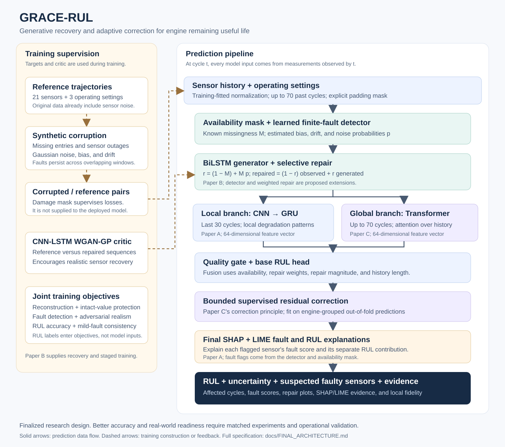

# Finalized research architecture: GRACE-RUL

**26 October 2026 reading note:** this file preserves the earlier design and
three-paper analysis, including proposed experiments. Current format-7 detector,
recovery, checkpoint and interval contracts are in [RECOVERY_V7.md](RECOVERY_V7.md).
Completed format-5/6 runs remain frozen local evidence. Earlier proposed
limits and statements about unexecuted training below are historical, not the
current runtime specification. Generated result archives are excluded from source publishing.

Generative Recovery and Adaptive Correction for Engine Remaining Useful Life

Design finalized: 8 October 2026; training audit and revisions: 11 October 2026.
Status: format-5 training, validation tuning, and matched comparator workflows implemented;
small execution checks passed. Complete research benchmarks remain outstanding.

User-requested addition: the final stage includes SHAP and LIME explanations of suspected sensor faults and their influence on predicted RUL.

The objective is to deliberately corrupt engine sensor measurements during training, learn to recover the reference measurements and their degradation information, and predict remaining useful life (RUL) from naturally imperfect inputs at deployment. The architecture below is derived from the three supplied papers. The detector, quality gate, and deployment-compatible correction are proposed extensions of their ideas; they are not results established by those papers.

Improved performance is a testable hypothesis. Neither combining the modules nor training on synthetic corruption establishes superiority over all three papers or readiness for industrial use.

## 1. Sources and analysis of each paper

### Paper A: hybrid CNN–GRU with reliability and explainability

- Local file: `1787574110586-178711702.pdf`.
- Author: Yıldırım Özüpak.
- Title: *A hybrid deep learning framework for reliable and interpretable remaining life estimation in turbofan Engines: Focusing on Robustness, Generalization, and Sensor-Level interpretability*.
- Publisher: Mechanical Systems and Signal Processing, 258 (2026), 114642.
- [Publisher page](https://www.sciencedirect.com/science/article/pii/S0888327026007995).

The model uses convolution to extract local sensor patterns and a GRU to model their temporal development. Its protocol includes all 21 sensors and three operating settings, 30-cycle windows, training-only normalization, engine-level validation splitting, capped training RUL at 125 cycles, and SHAP/LIME explanations. Repeated runs assess initialization sensitivity. Explicit perturbation experiments assess measurement robustness. See PDF sections 3.4, 4.1, 4.12, and Tables 4 and 14.

| Dataset | Reported RUL RMSE, cycles |
| --- | ---: |
| FD001 | 13.1 ± 0.4 |
| FD002 | 16.8 ± 0.6 |
| FD003 | 14.5 ± 0.5 |
| FD004 | 18.9 ± 0.7 |

On FD001, Gaussian noise with standard deviation 0.05 raises reported RMSE to 15.7; 20% sensor masking raises it to 15.9. Thus feature learning provides some tolerance, but it does not explicitly reconstruct a failed sensor. The paper's uncertainty section proposes Monte Carlo dropout as future work, rather than reporting a calibrated deployment uncertainty model.

There are reproducibility discrepancies: the prose describes three repeated runs whereas Table 5 specifies five; Tables 4 and 6 give different FD001 MAPE values; and the supposedly equivalent ablation baselines in Table 8 differ from the standalone results in Table 6. These discrepancies do not erase the useful architectural idea, but exact numbers should be treated as reported values pending reproduction.

**Retained:** CNN–GRU feature extraction, 30-cycle local context, all sensor channels, grouped validation, noise/masking tests, repeated runs, and SHAP/LIME. Monte Carlo dropout is included as an explicitly proposed uncertainty extension.

### Paper B: generative repair under partial sensor failure

- Local file: `1787574110595-209939890.pdf`.
- Author: Dongdong Tang.
- Title: *A deep learning framework for remaining useful life prediction of turbofan engines with partial sensor failure*.
- Publisher: PLOS One, 21(4), e0347312 (2026).
- [Publisher page](https://journals.plos.org/plosone/article?id=10.1371/journal.pone.0347312).

This is the closest match to the project's objective. It constructs corrupted/reference pairs using channel loss, intermittent masking, additive bias, and multiplicative drift. A BiLSTM generator with a fully connected decoder repairs the measurements. A CNN–LSTM Wasserstein critic, trained with gradient penalty, encourages realistic reconstructed sequences. A CNN–LSTM predictor estimates RUL. Reconstruction and RUL losses jointly train the repair process so that it preserves degradation information. The three phases are predictor pretraining, generator/critic training, and joint fine-tuning. See PDF pages 9–14.

| Reported experiment | Result |
| --- | --- |
| Reconstruction RMSE at 10% / 20% / 30% failure | 0.08 / 0.13 / 0.19, in normalized sensor space |
| Reconstruction SSIM at those rates | 0.97 / 0.95 / 0.91 |
| Full-model RUL RMSE | 12.15 cycles |
| Full-model NASA score | 228.47 |
| RUL RMSE after removing repair | 16.89 cycles |

Its limitations matter for this design. Experiments concentrate on FD001; the RUL table does not fully separate results by corruption family and severity. The reconstruction loss uses a mask identifying damage, but the deployment mechanism for locating finite-valued bias/drift faults is not fully specified. Ten-fold validation does not clearly establish grouping by engine, which matters because overlapping windows from one engine are dependent. A zero-filled missing reading also needs an explicit availability mask: zero can be a legitimate standardized value. The stated 18.3 ms latency is measured on an RTX 4090 and does not establish edge-device latency.

**Retained:** paired corruption/recovery training, BiLSTM repair, WGAN-GP, masked reconstruction, joint task-aware optimization, and staged training. **Extension:** a learned finite-fault detector supplies deployment-available repair weights.

The [1 September 2026 correction](https://journals.plos.org/plosone/article/file?id=10.1371/journal.pone.0357561&type=printable) was retrieved in the 14 October integration audit. It corrects the funding statement and does not revise the method or numerical results. Reported performance still needs independent reproduction under a comparable protocol.

### Paper C: Trans-D3 Transformer and prediction correction

- Local file: `1787574864583-423798354.pdf`.
- Authors: Jorge Paredes, Danilo Chavez, Ramiro Isa-Jara, and Diego Vargas.
- Title: *Trans-D3: A Novel Hybrid Transformer-Based Actor–Critic Approach for Remaining Useful Life Prediction*.
- Publisher: Sensors, 26(10), 2949 (2026).
- [Publisher page](https://www.mdpi.com/1424-8220/26/10/2949).

The Transformer supplies a base RUL estimate. A TD3 agent adds a bounded correction, using a quadratic error objective with an action-size penalty. This provides two useful ideas: attention over a longer history and regularized residual correction. Table 3 uses sequence lengths of 50–100 cycles depending on subset.

| Dataset | Reported RUL RMSE, cycles | Reported NASA score |
| --- | ---: | ---: |
| FD001 | 1.66 | 8.82 |
| FD002 | 13.23 | 114.33 |
| FD003 | 6.61 | 42.88 |
| FD004 | 12.26 | 406.93 |

These unusually strong numbers require a protocol audit. Section 3.1.2 describes actual RUL in the agent observation; section 3.3 describes an environment based on test-set values; but equation 17 defines the state as prediction plus normalized sample index. This is an inconsistency, and the test-label wording raises a material leakage concern. True RUL is unavailable when predicting a live engine. A dataset index may also encode ordering rather than degradation. These are reasons to require code-level clarification and independent reproduction, not proof of what an unavailable implementation did.

The paper also calls the estimator unbiased although the mean-error intervals in Table 8 exclude zero for FD001 and FD003. A confidence interval for the mean error across engines is not a prediction interval for a new engine. No comparable synthetic corruption-and-reconstruction benchmark establishes its recovery performance.

**Retained:** Transformer features, bounded additive correction, and the quadratic correction-size penalty. **Adaptation:** a supervised residual corrector using observable features replaces TD3 in the primary architecture. The described correction action does not change engine dynamics; its objective can be optimized directly from labeled training examples. A TD3 variant may be evaluated as an ablation with the same observable inputs and engine-disjoint training, but it is not necessary for the finalized design.

### Comparison boundary

The tables above summarize each paper's own experiment. They are not a common leaderboard: sensor selection, window lengths, target conventions, corruption distributions, validation, and correction inputs differ. An honest superiority claim requires rerunning the three approaches under one specified protocol.

## 2. Final architecture and origin of its modules



```text
Historical sensor measurements + operating settings
                         |
               Training-fitted normalization
                         |
                Availability mask + fault detector
                         |
                  BiLSTM sensor generator
                         |
                 Selective weighted repair
                         |
          +--------------+----------------+
          |                               |
   CNN -> GRU                       Transformer encoder
   last 30 cycles                   up to 70 past cycles
          |                               |
          +---------- Quality gate -------+
                         |
                   Base RUL prediction
                         |
               Bounded residual correction
                         |
        SHAP + LIME fault and RUL explanations
                         |
       RUL + empirical interval + sensor repair report

Training only:
reference data -> synthetic corruption -> corrupted/reference pairs
reference/repaired data -> WGAN-GP critic -> generator feedback
reference sensors + RUL labels -> reconstruction and prediction losses
```

| Module | Paper inspiration | Proposed improvement |
| --- | --- | --- |
| Corruption generation | A: Gaussian noise; B: missingness, bias, drift | Persistent trajectory-level faults and combinations |
| Fault detector | B: explicit damage locations; A: imperfect measurements | Estimate finite corruption without an oracle damage mask |
| BiLSTM repair and WGAN-GP | B | Condition on availability, estimated faults, and operating settings |
| CNN–GRU branch | A | Preserve short-horizon degradation information after repair |
| Transformer branch | C | Attend over a longer observed history |
| Quality gate | Synthesis of A, B, C | Learn how to combine the two branches using input quality |
| Bounded residual corrector | C | Train with labels as targets only, using observable inputs |
| SHAP/LIME explanations and uncertainty | A; C's error-distribution analysis | Explain suspected sensor faults and RUL impact; report repair provenance and validate empirical intervals |

The core contribution is the coupling of corruption detection, selective recovery, and quality-conditioned prediction. Every corrupted forward pass uses the estimated detector output, including during training. The synthetic damage mask supervises losses and evaluation only.

## 3. Data contract and preprocessing

At prediction cycle `t`, use at most the observed history `[t−69, ..., t]`. Inputs are 21 sensor channels and three operating settings. Unit ID identifies a trajectory; it is not a predictive feature. No failure time, future measurement, target RUL, engine ordering, or total lifetime enters the model.

Keep all 21 sensors initially, as in Paper A. Verify a 14-sensor alternative in a separate matched comparison, since Paper C uses a selected subset. A lack of temporal variation is not permission to discard a sensor before examining the operating conditions.

Split by engine before fitting transformations or making windows. For FD001/FD003, use training-fitted per-channel Z-score normalization. For FD002/FD004, condition normalization on the six operating regimes inferred from the three settings, using centers and per-regime statistics fitted only on the fitting engines. Floor each sensor's standard deviation at its smallest distinct fitting-data measurement increment (at least `1e-6`; entirely constant channels use `1`). This prevents nearly constant quantized measurements from becoming extreme standardized values. Sparse regimes fall back to global fitting sensor statistics. Regime-conditioned scaling is a proposed preprocessing adaptation to the multiple-condition problem described in all three papers.

Apply artificial sensor faults on each reference trajectory, then make windows. Overlapping windows must share the same realized fault history. Bias/drift should not reset arbitrarily at every window boundary. Maintain a separate finite/available mask; zero filling is only a numerical placeholder.

Short histories are left padded, with an explicit padding mask and valid-history fraction. Exclude padding from losses, pooling, recurrence, and attention. Do not silently remove test engines with fewer than 30 or 70 cycles.

The supplied C-MAPSS files already contain simulation sensor noise. Here, “reference” means the unmodified dataset, not noise-free physical truth. Recovery is measured against that reference after additional synthetic corruption.

Observed local snapshot:

| Subset | Training engines | Test engines | Training rows | Test rows |
| --- | ---: | ---: | ---: | ---: |
| FD001 | 100 | 100 | 20,631 | 13,096 |
| FD002 | 260 | 259 | 53,759 | 33,991 |
| FD003 | 100 | 100 | 24,720 | 16,596 |
| FD004 | 249 | 248 | 61,249 | 41,214 |

All trajectory rows contain 26 columns: unit, cycle, three settings, and 21 sensors. Local FD004 counts differ from the tables in Papers A and B and from the local readme; the actual input files and their hashes must define the experiment.

## 4. Corruption design

The sensor-failure experiment adapts the paper families using structured behavioral
models. Current protocol `structured-sensor-faults-v4` uses the following mechanisms;
its equations, raw-unit scales and limitations are documented in
[STRUCTURED_SENSOR_FAULTS.md](STRUCTURED_SENSOR_FAULTS.md).

| Family | Initial training range | How recovery is challenged |
| --- | --- | --- |
| Intermittent loss | Bursts on a related domain, mean four cycles | Common contact/acquisition loss with intact intervals |
| Whole-channel outage | Related channels unavailable after onset | Persistent sensor failure |
| Continuous missing block | Recurring 5–30 cycle blocks during curriculum | Interrupted telemetry |
| Correlated measurement noise | AR(1), rho .9; raw sigma = severity × fitting scale | Temporal memory, common/individual innovations, transition stress |
| Additive bias | Raw offset bounded by 2.5 × severity × fitting scale | Persistent calibration error |
| Additive drift | Offset ramps over 100 observed cycles by default | Calibration creep, including at zero normalized values |
| Stuck | Hold raw sensor reading at onset | Stale acquisition, including across changes in operating regime |

Severity is a dimensionless mechanism control, not a global corrupted-entry percentage.
Log actual affected channels, changed entries and active endpoints. Sensor-domain
groups are measurement-based hypotheses rather than verified C-MAPSS wiring.

Maintain 25% unmodified training examples to protect reference-data behavior. For the
remaining 75%, begin with individual mild faults, then introduce stronger faults and
related two-family combinations. Absolute onsets and fixed drift durations remain
independent of trajectory length/RUL; independent mechanism streams preserve corrupted
prefixes. Mixed cases share channels/onset and represent connector noise/dropout,
calibration bias/drift, or acquisition freeze/blocks. Fitting-only profiles define
raw-unit amplitudes. Use a fresh v4 training directory.

Validation and test corruption have deterministic seeds. Full-mode cases include
severity .4 and .5 and the same related mixed scenarios used in training; these
are not held-out combinations. A separate experiment withholding combinations
remains proposed. Reserve extrapolation cases for evaluation. Damage labels mark
only entries actually changed, including missing values; a stuck sensor matching
an unchanging reference is not labeled changed. Existing simulation noise and
engine degradation remain in the reference trajectories.

Do not corrupt RUL labels or operating settings in the primary sensor-recovery experiment. Missing settings are a separate unsupported-input condition until explicitly trained and tested.

## 5. Module definitions

Let `Y` be the corrupted normalized sensors, `O` the normalized operating settings, and `M` the availability mask: one means a finite sensor reading is available. Let `Y0` be zero-filled `Y`. The training-only mask `A` marks artificially altered entries; it is distinct from `M` because bias and drift remain finite.

### Fault detector

Input: `[Y0, M, O]`, 45 features per timestep. Initial network: parallel temporal convolutions with kernels 3 and 5, 32 channels each, followed by a 64-unit GRU and a per-timestep 21-output sigmoid head. It returns estimated finite-fault probabilities `p`.

Supervise `p` using `A` on available entries, with explicit clean examples. Per-channel positive BCE weights use square-root negative/positive counts bounded at 5. The sigmoid head starts at a conservative probability of approximately 0.018. Known missingness is handled directly by `M`. The detector must learn that true engine degradation and operating-condition changes can be legitimate signals; its false-positive rate is a primary metric.

### Sensor generator and selective repair

Input: `[Y0, M, p, O]`, 66 features per timestep. Initial network: two-layer BiLSTM, 64 hidden units per direction; a `128 -> 64 -> 21` residual decoder produces `G = Y0 + adjustment`. The decoder's final layer is initialized to zero, preserving finite readings initially and starting missing readings at the fitting-regime normalized mean. This residual parameterization is a project extension of Paper B.

Define repair weights and repaired measurements:

```text
r = (1 − M) + M * p
X_repaired = (1 − r) * Y0 + r * G
```

Unavailable readings use generated values. Finite readings are adjusted according to estimated corruption. Low fault probabilities retain most of the observed value. An identity loss penalizes unnecessary changes to uncorrupted entries; the model does not receive perfect reliability information.

The BiLSTM sees only the window ending at the current prediction time. Bidirectional processing inside already observed history does not permit looking beyond `t`. The system issues an endpoint prediction, rather than retroactively presenting earlier-window reconstructions as predictions made at those earlier cycles.

### Training critic

A conditional temporal CNN–LSTM critic scores reference and repaired sequences alongside operating settings. Use WGAN-GP, initially with gradient-penalty coefficient 10, as in Paper B's framework. The critic is removed from deployment. Start with reconstruction/detection warm-up before enabling adversarial updates; validate the critic-update ratio rather than assuming more updates are better.

### Prediction branches

Both branches receive repaired sensors, operating settings, availability, and repair weights: 66 features per timestep.

- Local branch: last 30 valid/padded cycles, parallel Conv1D kernels 3 and 5 with 32 channels each, then GRU with 64 hidden units. Output `h_local`, dimension 64.
- Global branch: up to 70 past cycles, feature projection to dimension 64, positional encoding, two Transformer encoder layers, four attention heads, feed-forward dimension 128, dropout 0.2. Output `h_global`, dimension 64.

Seventy cycles is an initial compromise supported by Paper C's longer histories; it is not claimed optimal. All Transformer attention excludes padding. Neither branch accesses future observations. Auxiliary heads produce `y_local` and `y_global` for branch supervision and disagreement reporting.

### Quality gate and base RUL

Construct a 64-dimensional quality vector `q`: 21 mean availability values, 21 mean repair weights, 21 mean absolute repair magnitudes, and one valid-history fraction. All means exclude padding.

```text
[w_local, w_global] = softmax(MLP([h_local, h_global, q]))
h = w_local * h_local + w_global * h_global
y_base = positive_RUL_head([h, q])
```

Initial gate: `192 -> 32 -> 2`; base head: `128 -> 64 -> 1`. Nonnegative output uses softplus. The gate adapts from observable quality; there is no predetermined rule that one branch must be more robust. Its usefulness must be shown against equal fusion and single-branch models.

### Bounded residual corrector

Observable input: `[q, y_base / 125, y_local / 125, y_global / 125]`, dimension 67. A `67 -> 32 -> 1` MLP returns:

```text
delta = b * tanh(corrector_output)
y_final = max(0, y_base + delta)
```

Initial bound `b = 15` cycles; full training searches 5, 10, 15, and 30 cycles on validation engines. The selected bound is a saved model buffer. Train with squared final RUL error plus a positive penalty on squared correction size, retaining Paper C's control-effort principle. Training targets may contain true RUL; model inputs never do. No correction-time reward or online label is needed at deployment.

Fit the corrector on engine-grouped out-of-fold predictions from the fitting partition, using both clean and mixed-corruption prefixes, so it learns errors on engines not used by the corresponding base model. Hidden fused features `h` are excluded: independently trained fold models can use different hidden coordinate systems, making their embeddings unsuitable as shared correction inputs. Freeze the final base pipeline during correction fitting. Include an always-zero correction as an epoch-zero candidate and retain it if all trained candidates worsen validation. Corrector checkpoints and the final seed use the same average of clean and mixed-corruption validation RMSE.

### Final SHAP and LIME sensor-fault explanation stage

Apply SHAP and LIME after the prediction pipeline is fitted. Explain two separate outputs: the detector's estimated fault score for each suspect sensor, and the final RUL prediction. This extends Paper A's window-level sensor explanations to the corruption-detection output introduced in this architecture.

**Fault identification:** known missing readings are reported directly from `M`. For available sensor `j`, threshold the detector outputs `p[t,j]` using validation-selected thresholds to mark suspected corrupted cycles and contiguous fault spans. Report the span's mean and maximum score, missing fraction, and repair magnitude. These scores are estimates, not calibrated fault probabilities unless probability calibration is separately performed. A binary detector does not establish a specific fault type; label finite anomalies as suspected corruption rather than claiming confirmed bias or drift.

**SHAP for fault evidence:** for each suspected sensor and span, explain a scalar target `f_j`, defined as the mean detector score for that sensor over the selected available cycles. Compute contributions over sensor/time blocks, then summarize them by input sensor while retaining the temporal attribution map. Contributions from other sensors can support a fault flag through inconsistency between channels. The suspect sensor is the detector's target `j`; the largest SHAP input contribution is not automatically the faulty sensor. Aggregate absolute contributions across held-out engines for a global view of the signals the detector relies on.

**LIME for a specific fault event:** fit a local surrogate to the same scalar detector target `f_j` for the engine window in question. Return the sensor/time blocks that raise or lower the estimated fault score, together with the surrogate's local fidelity. This explains why the current event was flagged, rather than substituting an RUL-importance ranking for fault detection.

**RUL impact:** separately apply SHAP and LIME to the complete mapping from the observed window through detection, recovery, fusion, and correction to `y_final`. Recompute intermediate model outputs for every explained input; do not treat generated values or predicted fault scores as independently adjustable measurements. If reported, calculate a separate repair sensitivity by replacing only the suspected sensor's observations with its candidate reconstruction, holding other observed sensor values fixed, and rerunning the pipeline. Label the prediction difference as a model-based sensitivity in cycles, not a proven physical or causal effect.

Use unmodified fitting windows from comparable operating regimes as the SHAP background and as sources of realistic LIME perturbations. Perturb coherent temporal blocks rather than independent time points. For finite-fault explanations, hold the actual availability mask, operating settings, and padding fixed. Missingness already has direct observational evidence and does not need SHAP or LIME to confirm it. Explain correlated sensors cautiously and report the perturbation/background policy with every evaluation.

The report for each engine includes:

| Output | Source and interpretation |
| --- | --- |
| Sensor ID and name | Canonical sensor channel, not its position in an importance ranking |
| Missing or suspected finite corruption | Availability mask or validation-thresholded detector output |
| Affected cycles and estimated fault score | Detector span localization; exclude padding |
| SHAP evidence | Signed sensor/time contributions to that sensor's fault score |
| LIME evidence and fidelity | Local explanation of the same fault score |
| Original and reconstructed trajectory | Shows the proposed recovery and its magnitude |
| RUL contribution and repair sensitivity | Separate explanation of prognostic influence, in cycles |

High RUL importance alone is not evidence of a sensor fault. SHAP and LIME explain the model's decisions; confirmed sensor faults require labeled fault evaluation or independent operational evidence. If their explanations disagree, show the disagreement rather than forcing agreement or suppressing the detector result. Compute detailed explanations on demand for flagged events and representative windows, and measure their latency separately from ordinary RUL inference.

## 6. Training losses and stages

Sensor losses operate in normalized space. RUL and consistency losses use RUL divided by 125 so their scales are documented. Every loss excludes padding.

- `L_rec`: mean squared repaired/reference sensor error on `A = 1`, divided by the number of altered entries.
- `L_generator_rec`: direct generated/reference sensor error on altered entries, providing supervision even before finite-fault probabilities become reliable.
- `L_trend`: error in consecutive repaired/reference sensor differences for valid pairs touching an altered entry; padding pairs are excluded.
- `L_identity`: squared repaired/reference error on `A = 0`, protecting unaltered observations.
- `L_detection`: binary cross-entropy for estimated finite faults, including clean controls.
- `L_adv`: negative Wasserstein critic score on repaired sequences.
- `L_RUL`: supervised squared RUL error for corrupted and reference examples.
- `L_consistency`: squared difference between corrupted-input and reference-input predictions for mild faults; stop gradient through the reference target. This is a proposed extension of A's perturbation-stability objective.
- `L_branch`: supervised errors of the two auxiliary branch heads.

Initial joint generator/detector/predictor objective:

```text
L = L_RUL + L_rec + 0.25 L_generator_rec + 0.5 L_identity
    + 0.2 L_detection + 0.1 L_trend
    + 0.01 L_adv + 0.1 L_consistency + 0.1 L_branch
```

These are starting weights for validation, not empirical optima. The Wasserstein critic uses its own adversarial and gradient-penalty objective. Keep the reconstruction weight positive; do not let an unconstrained trainable coefficient eliminate the recovery objective.

Strong consistency on nearly information-free inputs can teach plausible but unsupported predictions. Apply it only to mild corruption initially and assess it separately under severe failures. Good reconstruction alone is insufficient; low RUL error alone is also insufficient if the model distorts intact sensors.

Training sequence:

1. **Predictor pretraining:** train the two branches, gate, and base head on reference data. AdamW, initial learning rate 0.001, dropout 0.2, early stopping on engine-disjoint validation. Maximum 100 epochs is an initial budget.
2. **Repair pretraining:** freeze the predictor and disable its dropout; train detector/generator on paired faults, then enable WGAN-GP. Initial learning rate 0.0001; maximum 50 epochs. Retain identity and reconstruction supervision throughout. WGAN-GP uses all batch members for its Wasserstein term and a uniformly sampled sub-batch of up to 16 for the expensive recurrent gradient penalty. The consistency reference pass disables dropout in all stages.
3. **Joint optimization:** connect estimated detection, selective repair, and prediction. Train the whole pipeline with the joint objective and a smaller learning rate, initially for up to 20 epochs. Keep reference examples in every epoch. Retain the repair-stage checkpoint if every joint candidate worsens the same clean/mixed validation objective.
4. **Correction fitting:** generate grouped out-of-fold fitting predictions and train the bounded corrector on those observable features and RUL targets. Keep validation and official test engines out of its fitting data.
5. **Uncertainty assessment:** freeze parameters, then use separate calibration engines for empirical residual intervals and evaluate Monte Carlo dropout variability. No calibration labels become model inputs.
6. **Fault and prediction explanations:** with the model frozen, configure SHAP backgrounds and LIME block perturbations using fitting data. Produce detector and RUL explanations for validation/test events without using test fault masks to construct the explanations.

Split each official training subset into an 80% training pool and 20% validation by complete engine. Reserve 10% of that training pool for independent interval calibration, giving approximately 72% optimizer fitting, 8% calibration, and 20% validation overall, with integer-engine rounding. Calibration engines enter neither normalization nor any optimizer or checkpoint selection. Use three grouped folds within the fitting partition for correction features. Temporary fold models must fit preprocessing and every trainable upstream module using only their fold-training engines. Record their held-out detector/recovery/predictor metrics and mean/std summaries before fitting the final corrector; label these as upstream cross-validation rather than nested CV of the corrected pipeline. Fit the final base pipeline on the complete fitting partition with the selected configuration. Official test files remain separate throughout.

The implementation selects checkpoints using a predeclared average of reference and in-distribution mixed-corruption validation RUL errors. Repair candidates must also keep clean RMSE within 5% of the pretrained predictor, intact-entry normalized RMSE at most 0.15, and altered-entry reconstruction RMSE at most 1.5. If no repair candidate improves within those limits, the pretrained predictor is retained with repair bypassed. Correction selection separately protects clean RMSE and retains a zero-correction candidate. Final seeds are selected after correction with the same validation objective. Never select checkpoints from official test metrics. Use five full training seeds for the main study. Batch size 128 is an initial setting and may change for memory availability.

Full mode defaults to stride-1 windows and balances engine sampling by reciprocal window counts. The split seed and validation corruption seed stay fixed across initialization seeds and comparator variants. Validation uses three prefixes per engine; OOF correction uses six. Calibration retains one endpoint per engine. Validation plateaus reduce learning rates by a factor of 0.5, with patience 5 and a floor of 1e-6; scheduler state is included in epoch checkpoints.

Before final training, a small validation-only search compares loss weights, stride 1/5, and zero adversarial loss. It selects upstream settings without opening official test files, then fits OOF correction. Optional matched comparisons separately train architectural adaptations of the three papers and module ablations, with paired seed/engine bootstrap comparisons. Comparisons and extended robustness/ablation reports are disabled by default to reduce runtime. These share selected settings; they do not independently tune each baseline or reproduce Paper C's TD3. See [RESEARCH_TRAINING.md](RESEARCH_TRAINING.md) for the implemented protocol and remaining claim limitations.

Train a separate model per subset in the primary paper comparison. A model jointly trained on all subsets is an additional experiment, not evidence of cross-subset transfer. A transfer claim requires holding out the target subset's engines during fitting and reporting the protocol explicitly.

## 7. RUL labels and uncertainty outputs

For the paper-compatible initial experiment, training targets are `min(125, failure_cycle − current_cycle)`. Record target semantics in the saved model. Such training estimates a limited RUL horizon; it cannot establish accuracy for arbitrarily long real remaining life.

Specify whether each test table uses original official RUL targets or targets capped at 125. Report both as separate tables where practical, with identical conventions across models. Never compare a capped-label score with an uncapped-label score. A later uncapped-label deployment experiment needs separate training, model selection, and validation.

Use 20 Monte Carlo dropout passes as an initial diagnostic, following the uncertainty extension suggested in Paper A. Their variation is an uncertainty indicator, not a guaranteed prediction interval. Separately compute a nominal 90% empirical interval from the 5th and 95th percentiles of `true_RUL − final_prediction` on calibration-engine endpoint examples. Check coverage and width independently for each fault family and severity.

Use one preselected endpoint per calibration engine for the primary interval estimate; overlapping prefixes are not independent calibration engines. Limited calibration-engine counts must be reported. Synthetic faults and Monte Carlo dropout do not guarantee coverage under new industrial distributions.

Each deployed prediction should include RUL in cycles, the interval and its validation scope, missing sensors, estimated finite-fault scores, affected cycles, repair magnitude, branch weights, and insufficient-history/unsupported-condition indicators. The final explanation report includes SHAP and LIME evidence for each flagged sensor and separate sensor contributions to final RUL. Heavy sensor loss must remain visible; reconstructed values are estimates, not new measurements. SHAP/LIME explanations are post-hoc contributions, not physical causal proof.

## 8. Validation required to establish improved performance

The primary claim to test is: **selective generative recovery with quality-conditioned local/global prediction reduces RUL error under sensor faults while preserving reference-data accuracy.** Recovery quality and RUL robustness are separate outcomes.

Use the same official train/test files, engine partitions, target definitions, feature conventions, corruptions, seeds, and evaluation endpoints for every model. Report original-protocol reproductions separately from harmonized comparisons. Original paper hyperparameters and the proposed model should receive a disclosed, comparable tuning budget.

Required comparators are Paper A's CNN–GRU, Paper B's repair plus CNN–LSTM, and a deployment-compatible version of Paper C's Transformer plus TD3. Report pure Transformer as well. Paper C's published numbers remain historical reported results until its test-label and state inconsistencies are resolved; a corrected reimplementation must be labeled as such.

For every subset, evaluate reference input and each specified fault severity using one final-observed-window RUL prediction per official test engine. For persistent faults, corrupt the observed trajectory before building that window. Use independent saved corruption replicates with identical draws across models. Additional prefix predictions support temporal diagnostics and do not replace the endpoint benchmark.

Required measurements:

| Measurement | Reason |
| --- | --- |
| Altered-entry sensor RMSE and MAE, per channel and fault family | Quantify recovery rather than averaging mostly intact values |
| Unaltered-entry repair error | Detect damage caused by the repair system |
| Finite-fault precision, recall, false-positive rate, PR-AUC | Establish whether repair locations can be found without an oracle |
| Fault explanation fidelity and stability across backgrounds/perturbations | Check that SHAP/LIME explanations describe detector behavior consistently |
| LIME local surrogate fit and attribution-directed perturbation checks | Quantify explanatory faithfulness rather than visual plausibility |
| Endpoint RUL RMSE and MAE | Assess prognostic accuracy |
| NASA score, total and per engine | Penalize overly optimistic remaining-life estimates |
| Relative RMSE increase versus reference input | Measure robustness loss |
| Interval coverage and width | Assess empirical uncertainty behavior |
| Parameters, peak memory, mean and p95 latency at batch size 1 | Assess feasibility on the actual target hardware |
| SHAP/LIME explanation latency, separately from prediction latency | Disclose the cost of detailed fault reporting |

Evaluate sensor fault localization against the synthetic damage mask using detector outputs; do not score SHAP's explanatory input ranking as though it were a fault-label classifier. Assess explanations by local fidelity, repeatability, and whether changing highly attributed sensor/time blocks changes the explained output as expected. Evaluate RUL explanations separately from fault-score explanations.

Use the NASA score with `d = prediction − truth`: `exp(−d/13) − 1` for `d < 0`, and `exp(d/10) − 1` otherwise. Report mean score alongside totals because subsets contain different engine counts. Reconstruction normalized RMSE must not be compared directly with RUL RMSE in cycles.

Bootstrap at engine level while retaining each engine's dependent corruption replicates; also report variation across full training seeds. Do not bootstrap individual overlapping windows as independent samples.

Required ablations:

1. Predictor on corrupted input without learned repair.
2. Same repair module with CNN–GRU only and Transformer only.
3. Equal branch fusion instead of the quality gate.
4. Generator without adversarial training.
5. Recovery without joint RUL feedback.
6. No residual correction, supervised correction, and observable-input TD3 correction.
7. Estimated fault locations versus oracle synthetic locations, with the oracle explicitly labeled as an upper-bound experiment.
8. Single-family training versus mixed corruption training.

Predeclare the main aggregate as equal-weight average RUL RMSE across subsets, fault families, and specified severities; also disclose every individual cell. A proposed acceptance target is at least a 10% improvement over the strongest harmonized comparator on that corrupted-input aggregate, with a paired engine-level uncertainty interval supporting improvement, and at most a 5% relative loss in reference RMSE per subset. These thresholds are research decisions, not achieved results. Any severe per-condition regression must be disclosed even when the average improves.

Real-world readiness additionally requires evaluation on genuine operational histories with independently verified sensor faults and known outcomes, using temporally separated fleets or periods, and latency measured on the intended hardware. The available C-MAPSS snapshot can establish simulated-benchmark evidence only.

## 9. Final design decision

The finalized architecture is **estimated corruption detection -> selective BiLSTM/WGAN-GP recovery -> quality-gated CNN–GRU and Transformer prediction -> bounded supervised residual correction -> SHAP/LIME explanations of suspected sensor faults and RUL impact**.

It addresses the requested corruption-and-recovery objective directly and gives every paper a concrete role. Training and the matched architectural comparison workflow are implemented. Complete benchmark training, original-protocol paper reproductions, measured superiority, and real operational validation remain research work.
