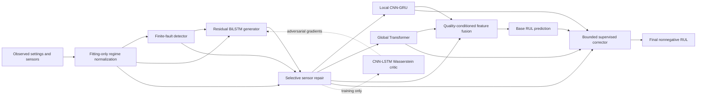

# Paper integration audit - 14 October 2026

GRACE-RUL combines the main architectural ideas coherently: selective recovery feeds a local CNN-GRU branch and a global Transformer branch, their features are fused, and a bounded supervised corrector adjusts the prediction. The implementation is a paper-inspired hybrid with explicitly different losses, preprocessing, and evaluation procedures. It does not establish the three papers' reported performance.

One confirmed methodological issue needs attention before the next substantial training study: synthetic fault timing and drift can depend on the engine's final trajectory length. This can couple the corrupted input to remaining life even though the neural network does not receive RUL labels as features. The strength of any resulting shortcut in a trained model is unknown.

The faster defaults from the preceding change are retained. This audit changes documentation and records checks; it does not change the model or fault-generation protocol.

## Sources and scope

The supplied PDFs were re-read for architecture, losses, preprocessing, training, evaluation, and limitations. Relevant equation/architecture pages were also rendered and visually inspected.

| Source | Local PDF | Relevant locations |
| --- | --- | --- |
| A: Yildirim Ozupak, hybrid CNN-GRU and REE, MSSP 258, 114642 (2026) | [Paper A](../1787574110586-178711702.pdf) | PDF pp. 4-10, 11, 17-18: CNN-GRU, input windows, targets, REE objectives, training, repeated runs, perturbation tests |
| B: Dongdong Tang, partial sensor failure, PLOS ONE e0347312 (2026) | [Paper B](../1787574110595-209939890.pdf) | PDF pp. 9-14, 16-19: paired corruption, BiLSTM, WGAN-GP, predictor, three training stages, metrics and computational cost |
| C: Paredes et al., Trans-D3, Sensors 26, 2949 (2026) | [Paper C](../1787574864583-423798354.pdf) | PDF pp. 10-17, 23, 26: Transformer, TD3 correction, states, reward, selected features and methodological limitations |

Tang's [1 September 2026 correction](https://journals.plos.org/plosone/article/file?id=10.1371/journal.pone.0357561&type=printable) was retrieved during this audit. It corrects the funding statement; it does not revise the architecture, equations, or numerical tables. The earlier unresolved correction note can therefore be closed.

Reviewed implementation: `grace_rul/model.py`, `data.py`, `training.py`, `tuning.py`, `artifacts.py`, `benchmark.py`, `explain.py`, the generated notebook, and website inference/export consumers. Earlier audit documents were treated as context and checked against current source.

## What each paper contributes

| Paper | Implemented contribution | Deliberate adaptation or remaining gap |
| --- | --- | --- |
| A | Convolutions followed by GRU in the 30-observation local branch; all 21 sensors and 3 settings; capped training targets at 125; AdamW; grouped validation; repeated initialization seeds; SHAP/LIME support | The local branch receives recovered values and reliability features and is fused with a Transformer. The 70-observation upstream recovery window can influence its last 30 observations. The generalized REE perturbation-variance and SHAP/LIME-correlation objectives in equations 20-22 are not implemented literally. Current explanations are individual-window reports, rather than a completed global attribution study. |
| B | Paired corrupted/reference trajectories; BiLSTM generator; CNN-LSTM scalar critic; Wasserstein loss with gradient penalty; losses on altered entries; predictor pretraining, recovery training and joint fine-tuning | Residual initialization, an estimated finite-fault detector, selective blending and trend/identity losses extend the method. The primary RUL predictor uses the combined A/C branches. Loss weights are configured/tuned rather than implementing the paper's learnable eta. Recovery uses a longer window; grouped OOF correction has three folds rather than reproducing ten-fold paper evaluation. SSIM is not implemented. |
| C | Projected Transformer inputs, positional encoding, attention, final-valid-position summary; bounded additive correction and a positive correction-size penalty | Correction is supervised, with observable features and engine-held-out predictions. TD3's actor, twin critics, replay buffer and target updates are absent. This retains the attention/correction idea while changing the optimization algorithm. The paper's 14-sensor/min-max settings and per-subset Transformer parameters are not reproduced. |

The learned detector, quality gate, residual repair initialization, operating-regime scaling and grouped correction design are project contributions. They should be identified separately from the papers in a thesis or report.

Paper C's PDF p. 11 describes actual RUL as part of the correction observation, while p. 13 discusses test-set values and defines a different state using prediction and sample index. These descriptions require clarification before reproducing its numerical claims. They are a protocol concern, not proof of the behavior of an unavailable author implementation. GRACE-RUL uses neither actual RUL nor engine/test ordering as correction inputs.

## Connections in the current model

The diagram abbreviates reliability inputs and auxiliary predictions. Actual wiring is in [model.py](../grace_rul/model.py), especially lines 90-145. Dimensions below use the full default configuration.

| Interface | Source dimensions | Assessment |
| --- | --- | --- |
| Detector | 21 zero-filled sensors + 21 availability indicators + 3 settings = 45 | Consistent with convolution inputs |
| Generator | 21 sensors + 21 availability indicators + 21 estimated probabilities + 3 settings = 66 | Consistent with the bidirectional LSTM; output has 21 sensors per position |
| Predictor branches | 21 repaired sensors + 3 settings + 21 availability indicators + 21 repair weights = 66 | Both branches receive the same repaired observations and reliability context |
| Fusion quality | 21 mean availabilities + 21 mean repair weights + 21 mean absolute repair changes + 1 valid-history fraction = 64 | Matches gate and prediction-head inputs |
| Fusion | Two 64-dimensional branch features with softmax weights | Weights sum to one; fused feature dimension remains 64 |
| Corrector | 64 quality summaries + base/local/global RUL divided by 125 = 67 | Matches the correction MLP; arbitrary fold-specific hidden embeddings are excluded |
| Critic | 21 repaired/reference sensors + 3 settings = 24 | Conditional scalar score; critic is excluded from deployed inference |

These are source-level shape and connection checks. Neural forward/backward execution was unavailable in this environment.

Selective repair uses estimated probabilities for finite readings and known availability for missing readings. If `M` is availability and `p` the estimated probability, repair weight is `r = (1-M) + M*p`. The repaired value blends the observed value and generated value using `r`. Training damage labels supervise losses; they are not supplied to `GraceRUL.forward`.

Both branches operate on windows ending at the prediction endpoint. Bidirectional recovery and unrestricted attention operate within already observed history; they do not consume observations after that endpoint. Left padding is excluded by packed recurrence, attention masks and masked summaries. This does not make retrospective reconstructions of earlier positions equivalent to predictions issued at those earlier times.

## Training and optimization check

| Stage | Trainable parameters and objective | Assessment |
| --- | --- | --- |
| Predictor | Predictor parameters; reference inputs; base and auxiliary RUL MSE | Implements clean predictor pretraining |
| Generator/detector | Predictor frozen; detector/generator receive reconstruction, detection and task gradients; critic enabled after warmup | Task gradients flow through the frozen predictor into recovery; predictor dropout is disabled in this stage |
| Joint | Detector, generator and predictor; corrector excluded | Fine-tunes recovery and RUL together; selected recovery-stage weights remain eligible |
| Corrector | Only correction MLP; clean and corrupted OOF feature/target pairs | Trains on fitting-engine labels held out of the generating fold model; outer validation chooses correction weights and bound |

See [training.py](../grace_rul/training.py), lines 92-124, 141-169, 277-406 and 409-499.

The critic minimizes `D(fake) - D(real) + gradient_penalty`. The generator's adversarial term is `-D(repaired)`. Fake values are detached during critic updates; critic parameters are frozen for generator updates while gradients through critic inputs remain available. Gradient penalty is estimated on a uniformly sampled sub-batch of up to 16, rather than the paper's full batch, to reduce recurrent second-derivative cost.

Recovery combines RUL MSE, altered-entry reconstruction, direct generator reconstruction, intact-entry identity, finite-fault BCE, temporal trend, adversarial, mild-corruption consistency and branch supervision. Their weights are applied through model configuration. This is a project objective, rather than a literal copy of any one paper's complete loss.

The correction is `bound * tanh(MLP(features))`; final RUL is clamped below at zero. Its objective is squared corrected error plus `0.02 * squared correction`, with both scaled by the target scale. A zero-correction candidate and the uncorrected validation score remain eligible. Validation also limits clean-RUL regression. There is no need for a deployment-time reward or true RUL input.

Pipeline checkpoints and final seeds use the average clean/mixed validation RMSE. Recovery additionally protects clean RMSE, intact readings and altered-entry reconstruction. Test metrics and calibration labels are not used for checkpoint or seed selection.

## Findings requiring attention

### 1. Synthetic faults depend on the final trajectory length

**Priority: address before a substantial robustness training study.** In [data.py](../grace_rul/data.py), line 131 samples fault start relative to `n // 2`, and lines 148-150 ramp drift across `n - start` positions. `n` is the complete training-engine trajectory length, which also determines training RUL. The same observed history can therefore receive different corruption when only its unseen future length changes.

A deterministic reproduction used identical first 30 observations, identical fault start (position 2), identical affected channels and identical slope, then changed the full trajectory from 60 to 120 observations. The maximum difference in the corrupted first 30 observations was **0.0485829115 normalized units**. The difference arises solely from the drift-ramp denominator.

This confirms a simulator dependency on future length. It does not measure how strongly a trained predictor exploits it. Fault onset expressed as a fraction of lifetime creates an additional coupling risk. The earlier statement that the current simulator's starts/durations are independent of RUL was too strong.

Recommended correction: sample fault processes using absolute observed-cycle timing or a fixed horizon independent of eventual failure, and define drift using elapsed time after onset with an independently selected duration. Extending an identical trajectory must not alter its previously generated corrupted prefix. Preserve shared fault histories across overlapping windows. This is a training-data protocol change and needs fresh training and validation; it is not silently applied as part of a review.

### 2. Presence in the architecture does not guarantee selection in a trained artifact

The validation search includes a candidate with adversarial weight zero ([tuning.py](../grace_rul/tuning.py), lines 13-19). An accepted subset configuration can therefore omit adversarial training. Recovery can also be bypassed when it fails validation constraints, and the corrector can retain zero adjustment. These are sensible fallbacks, but claims about a deployed model must inspect its saved configuration, `repair_selected`, `correction_bound`, and correction history.

A paper or thesis should distinguish an available component from a component that actually contributed in the selected run.

### 3. Faster defaults leave robustness and comparison evidence incomplete

`run_matched_benchmarks` and `run_extended_evaluation` are false by default; the notebook's automatic explanation example is also disabled. Core training, tuning, correction, calibration, clean endpoint metrics and upstream CV remain enabled. Thus the speed changes do not remove the A/B/C prediction/recovery connections, but they reduce the evidence generated automatically.

Before claiming improved sensor-fault robustness, generate the optional recovery/detection/RUL reports. Before claiming an improvement over other architectures, run the comparison models. These can be enabled after core training with the same training settings and run directory to reuse completed upstream checkpoints; correction and evaluation are recomputed. The comparator implementations are harmonized adaptations, including supervised correction for C, rather than original-protocol reproductions.

### 4. OOF correction and uncertainty have narrower scopes than some paper claims

Fold metrics describe upstream detector/recovery/predictor performance. They are not nested cross-validation of the final corrected model: outer tuning is shared, and the final corrector learns from OOF targets. Official test endpoints supply the separate final-pipeline assessment.

Calibration intervals are empirical residual quantiles on unmodified, capped-target calibration endpoints. Their coverage under faults, domain shift or uncapped long-life labels is unestablished. MC dropout is a variability diagnostic. SHAP/LIME reports contributions under the chosen perturbation/background scheme; neither establishes a physical cause of sensor failure.

### 5. Learned performance is currently unverified

No `.pt`, `.pth`, `.ckpt` or `.safetensors` weights were found in this project, and the model manifest remains `awaiting_training`. The model's learned finite-fault sensitivity, repair quality, branch use, correction benefit and accuracy cannot be measured from an architecture review.

PyTorch is unavailable in the current tool environment. Historical validation documents are not substituted for new full-model gradient, GPU or performance checks.

## Checks executed during this audit

The actual data preparation, normalization and corruption code was exercised with NumPy/pandas/scikit-learn. Lightweight tensor wrappers replaced conversion functions only; this did not execute a neural network or a PyTorch training loop. The record is in [INTEGRATION_AUDIT_DATA_CHECKS.json](INTEGRATION_AUDIT_DATA_CHECKS.json).

| Subset | Training/test engines | Fitting/validation/calibration | Regimes | Official test endpoints |
| --- | --- | --- | --- | --- |
| FD001 | 100 / 100 | 72 / 20 / 8 | 1 | 100 |
| FD002 | 260 / 259 | 187 / 52 / 21 | 6 | 259 |
| FD003 | 100 / 100 | 72 / 20 / 8 | 1 | 100 |
| FD004 | 249 / 248 | 179 / 50 / 20 | 6 | 248 |

Checks passed for disjoint fitting/validation/calibration sets, OOF inner/held-engine separation, fitting-only scaler membership, finite transformed data, 70-by-24 observation windows, 70-by-21 training masks, capped/raw target separation, one official endpoint per test engine, and exact overlap consistency of cached trajectory corruption. The future-length drift dependency was reproduced separately and remains an open finding.

## Recommended next sequence

1. Resolve the simulator's future-length dependency and specify the revised corruption protocol.
2. In the project's real PyTorch environment, run model/gradient and checkpoint-resume checks before a new full training run.
3. Keep the current main architecture, five-seed selection, grouped correction, validation and calibration unless a measured ablation justifies changing them.
4. Inspect selected artifacts for actual recovery, adversarial and correction use. Report clean and corrupted accuracy separately.
5. Generate comparisons, robustness reports and explanations when preparing research evidence, using the optional switches rather than making every development run train the comparators.
